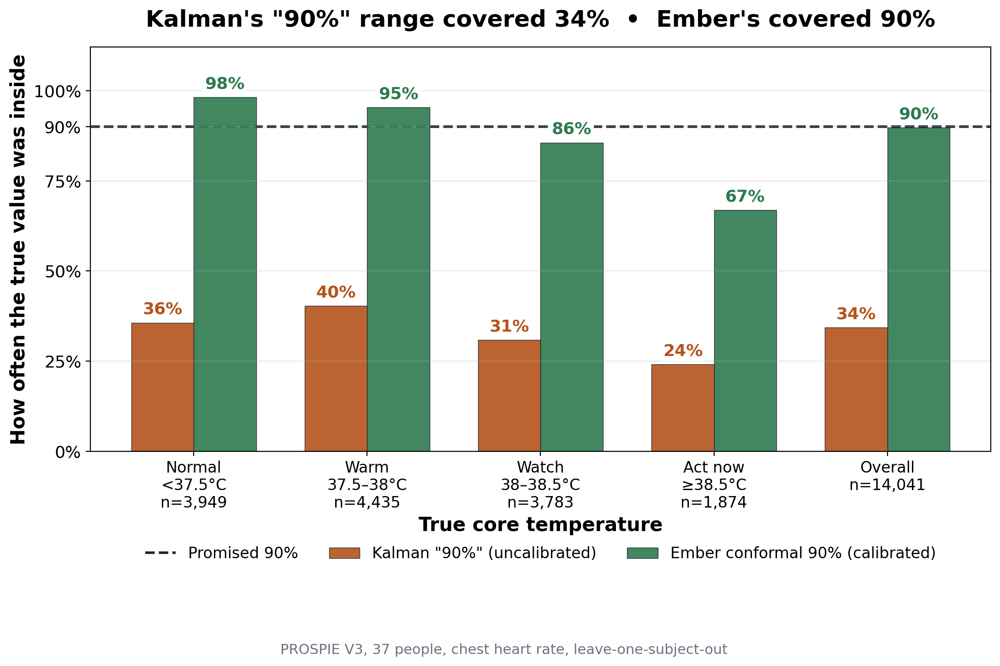

# Ember (EMB.R)

**A chest-worn core-temperature estimator that tells you how sure it is, and says so when it can't tell.**

Heat stroke is defined by core body temperature, which can't be measured in the field without a swallowed pill or a rectal probe. The standard workaround estimates it from heart rate with a published Kalman filter (ECTemp, Buller et al. 2013). That filter's own "90 %" range contained the true value **34 %** of the time in our tests.

Ember runs the same filter on a $30 board and changes what it shows:

- **A calibrated range.** The ± comes from conformal prediction on measured errors against rectal temperature in 37 people. It covered **89 %** when it promised 90 %.
- **A learned correction.** A small linear model, using the wearer's own resting heart rate, cuts the error from 0.41 to **0.32 °C**.
- **A refusal mode.** Skin temperature and motion check whether a high heart rate has a thermal explanation. When the pulse is lost or the signals disagree, the app shows *Paused* and the reason instead of a number.
- **Never silent when it matters.** From 38.0 °C up it never refuses: it shows the number, tagged *Low confidence* if needed.

Built at the DS+X Hackathon, Boston University, October 2026. **Not a medical device.**



---

## Results

Leave-one-subject-out on PROSPIE (37 people, 128 trials, 14,041 minutes, rectal reference), plus an external test on HTT (65 people the model never saw, ingestible-pill reference, nothing refitted).

| | PROSPIE | HTT (external) |
|---|---|---|
| Kalman "90 %" range, actual coverage | 34 % | 27 % |
| Ember 90 % range, actual coverage | **89 %** | **82 %** |
| Error (RMSE), filter alone → Ember | 0.41 → **0.32 °C** | 0.49 → **0.40 °C** |
| Average ± | 0.49 °C | 0.51 °C |
| People the correction helped | 31 / 37 | 54 / 65 |
| Coverage at true core ≥ 38.5 °C | 71 % | 90 % |

- **Alert timing (PROSPIE).** When true core first reached 38.5 °C, Watch (38.0) was already on in 65 of 73 trials, a median 12 minutes ahead. Act now (38.5) never fired in 27 of 73. Watch carries the safety load because the estimate lags.
- **Men vs women.** Bias difference −0.06 °C (95 % CI −0.16 to +0.05) on PROSPIE, +0.12 °C (−0.00 to +0.24) on HTT. No clear difference; neither rules out a small one.
- **Where it's weakest.** It lags a fast rise (71 % coverage at ≥ 38.5 °C on PROSPIE). On HTT, late in two-hour walks, heart rate drifts up while core levels off, so it over-reads: more false alarms, not more misses.

Full results: [`analysis/JUDGES_SUMMARY.md`](analysis/JUDGES_SUMMARY.md). Background and literature: [`docs/SCIENCE.md`](docs/SCIENCE.md).

---

## How it works

```
  pulse sensor ─┐
  skin A, B ────┤      ESP32-S3 (firmware/ember)
  air C ────────┼──►  ECTemp filter, once a minute
  IMU (motion) ─┘      + learned correction (after BASELINE)
                       + conformal ± from conformal_table.h
                       + doubt checks → OK / CAUTION / REFUSE
                               │
                               │  Bluetooth LE, one 20-byte frame a second
                               ▼
                       Web app in Chrome (webapp/)
                       Personal · Coach · Supervisor views

  conformal_table.h  ◄──  analysis/export_firmware_table.py  ◄──  PROSPIE
```

The device does all the estimation. The app decodes the frame and displays it; it never recomputes the number or the range. The Bluetooth contract (UUIDs, frame layout, flags, display rules) is in [`docs/APP_INTERFACE.md`](docs/APP_INTERFACE.md).

### What the app shows

| Status | When | Colour |
|---|---|---|
| OK | estimate below 38.0 °C | light blue |
| Watch | 38.0 °C and up | amber |
| Act now | 38.5 °C and up (ACGIH work limit) | red |
| Paused | the device withholds the number (below 38.0 °C only) | slate |

*Low confidence* tags the number when the device is less sure (one doubt, or a pulse reading dropped for matching the step rate), with the reason beside it. *Setting up* covers the 5-minute resting baseline.

The **Personal** view is the live wearer screen: status, ±, trend, a forecast range, a break and water plan, a 30-minute chart, and "How sure is Ember?" with the real coverage numbers. **Coach** (12-player team) and **Supervisor** (crew alerts, no body data) are static examples of how the same signal would be shared. An **Emergency help** button on every view shows 911 and heat-illness first-aid steps, plus an optional chat with Claude.

---

## Repository layout

```
firmware/ember/
  ember.ino              ESP32-S3 sketch: sensors, BLE, serial commands
  ember_core.h           all the maths: ECTemp, correction, thermistors, heart rate, flags, frame
  conformal_table.h      generated by analysis/export_firmware_table.py
webapp/                  the app: vanilla JS modules, no build step, no framework
  src/lib/               frame decoder, Bluetooth / USB / demo / replay sources, datastore
  src/views/             Personal, Coach, Supervisor, Emergency help
  demo/                  sample session for replay
tools/ember_ble.py       laptop BLE client and reference frame decoder
tests/                   firmware unit tests (C++), webapp tests (node), Arduino stubs
analysis/                evaluation, calibration export, external test, results
figures/                 result figures
hardware/
  wiring_v5.html         pin map, schematic, protoboard layout, every connection
  cad/                   enclosure and power-bank pod (CadQuery source, STEP, STL)
docs/
  APP_INTERFACE.md       the Bluetooth contract
  SCIENCE.md             the problem, the literature, what Ember adds, limits
  BOM.md                 original v1 parts list (superseded by hardware v5 below)
```

---

## Getting started

### Run the app (no hardware needed)

ES modules don't load from `file://`, so serve the folder locally:

```bash
cd webapp
python3 -m http.server 8000
```

Open <http://localhost:8000> in Chrome. It starts in **Demo** mode: a simulated session through baseline, a work bout past 38.5 °C, and recovery, sent through the same frame decoder the device uses. Other views: `?view=coach`, `?view=supervisor`. The connection chip offers Bluetooth, USB serial (bench), the demo, and a replay sample.

### Build the device (hardware v5)

| Part | ESP32-S3 pin | Notes |
|---|---|---|
| ESP32-S3-DevKitC-1 | | powered over USB-C from a power bank |
| Analog pulse sensor | GPIO4 | on the chest |
| Skin thermistors A / B (10k NTC + 10k divider, R1 / R2) | GPIO6 / GPIO7 | against the skin |
| Air thermistor C (10k NTC + 10k divider, R3) | GPIO5 | outside the strap, display only |
| Battery sense, R4 to GND | GPIO8 | reads "no battery" on the power-bank build |
| GY-521 IMU (0x68) | SDA GPIO17, SCL GPIO18 | motion and step cadence |

Every analog input is on ADC1, because ADC2 is unusable while Bluetooth runs. Full wiring: open [`hardware/wiring_v5.html`](hardware/wiring_v5.html) in a browser. Enclosure: [`hardware/cad/CAD_NOTES.md`](hardware/cad/CAD_NOTES.md).

On the demo board all three thermistor dividers are built upside down (thermistor on the 3V3 side). `NTC_A_ON_TOP`, `NTC_B_ON_TOP` and `NTC_C_ON_TOP` in `ember.ino` handle that; set one to 0 if its divider matches the diagram, then rerun `CAL`.

### Flash the firmware

Arduino IDE with the **esp32 core 3.3.12**, board **ESP32S3 Dev Module**. No extra libraries. Open `firmware/ember/ember.ino` and upload. Set *USB CDC On Boot* to *Disabled* on the port marked UART, *Enabled* on the port marked USB.

From the command line:

```bash
arduino-cli compile --fqbn esp32:esp32:esp32s3 --warnings all firmware/ember
```

Then, on the serial monitor at 115200 (type `HELP` for the full list):

| Command | What it does |
|---|---|
| `ID` | firmware version (2.3.0) and configuration |
| `SCAN` | I²C scan, expect `0x68` |
| `HR`, `TEMP`, `IMU` | live heart rate, thermistors, motion |
| `CAL` | makes the three thermistors agree at room temperature (about ±0.6 °C absolute). Required before use: the skin checks stay off until it runs |
| `BASELINE` | 5 minutes seated rest: resting heart rate and starting core temperature. Turns on the learned correction |
| `START` / `STOP` | 19-column CSV log at 1 Hz |

`BASELINE` is also sent from the app ("Start baseline") during setup.

### A session

1. Run `CAL` once per board; `ID` should say "thermistor calibration: yes".
2. Put the strap on, open the app, choose **Connect EMB.R** and pick `Ember`.
3. **Start baseline** and sit still for 5 minutes.
4. Work, then recover. Choose work whose step rate is far from your heart rate (step-ups, cycling) rather than running: with one pulse sensor, nothing else cross-checks the heart rate.

Keep the page open: after a reload, Chrome asks you to pick the device again.

### Laptop client

```bash
pip install bleak
python3 tools/ember_ble.py                    # live readout
python3 tools/ember_ble.py --csv bout.csv     # and log every frame
python3 tools/ember_ble.py --send BASELINE    # send a command, then watch
```

The device takes one Bluetooth connection at a time, so close the app first.

### Reproduce the analysis

Both datasets are in `analysis/`.

```bash
cd analysis
pip install -r requirements.txt
python3 ectemp.py                 # ECTemp coefficient self-check
python3 conformal.py              # conformal self-test
python3 evaluate.py --data "Prospie dataset_open access V3.xlsx" --prefix ember_chest
python3 judges_results.py         # numbers in JUDGES_SUMMARY.md
python3 external_test.py          # HTT external test
python3 make_judge_figures.py     # figures/judges_*.png
```

`evaluate.py --no-correction` gives the filter alone. To regenerate what the device and app ship (never hand-edit these files):

```bash
python3 export_firmware_table.py --data "Prospie dataset_open access V3.xlsx" \
    --out ../firmware/ember/conformal_table.h \
    --js-out ../webapp/src/lib/conformal_table.js \
    --vectors-out ../tests/correction_vectors.h
```

### Run the tests

From the repo root:

```bash
# firmware maths, including C vs Python on golden vectors
g++ -std=c++17 -O2 -Wall -Wextra -Ifirmware/ember tests/test_core.cpp -o /tmp/test_core && /tmp/test_core

# the sketch type-checks against host stubs (a real ESP32 build needs arduino-cli)
g++ -std=c++17 -fsyntax-only -Itests/stubs -Ifirmware/ember -x c++ firmware/ember/ember.ino

# reference decoder, and its flag order against ember_core.h
python3 tools/ember_ble.py --selftest

# webapp: frame decoder, bench CSV, datastore rules, Bluetooth link against a fake device
node --test tests/test_frame.mjs tests/test_link.mjs
```

---

## Privacy

- **Nothing is stored.** No accounts, no server, no localStorage, cookies or IndexedDB. Session data lives in memory and is gone when the page closes.
- **The Supervisor view never shows body data**, only events such as "rest break taken".
- **Outbound requests:** Google Fonts (Inter), Open-Meteo for local weather (latitude and longitude only), and, only if someone uses the Emergency help chat, the Anthropic API with the conversation text. The chat never receives heart rate, temperatures, location or name. Its API key is pasted into the panel, kept in memory, and never stored.
- The Bluetooth link and the local web server have no authentication. It's a single-wearer demo; don't run it on a shared network as-is.

---

## Limits

- **Not a medical device.** For demonstration with consenting adults. Thresholds are recommendations, not diagnoses.
- **No ground truth on our hardware.** We validated the method and the calibration on published data, not the physiology of this device.
- **Calibrated on chest ECG heart rate.** The demo uses a low-cost analog pulse sensor; a product would use a validated heart-rate sensor.
- **The estimate lags** a fast rise and reads low at the top of the range. Treat Watch as the action threshold.
- **Beta blockers** lower heart rate, so the estimate reads low for people taking them. Nothing here detects that.
- The break and water schedule (20 min on / 5 off, 250 ml every 15 min) is a placeholder, not taken from a published work/rest table.

---

## Data and licences

- **PROSPIE V3**, Loughborough University, DOI [10.17028/rd.lboro.26076577](https://doi.org/10.17028/rd.lboro.26076577), CC BY-NC 4.0 (non-commercial). Training and calibration.
- **HTT**, hot vs thermoneutral exercise, DOI [10.17632/g5sb382smp.1](https://doi.org/10.17632/g5sb382smp.1), CC BY 4.0. External test only.
- **ECTemp**: Buller et al., *Physiological Measurement* 34:781–798 (2013). The method is patented (US 10,702,165 B2).

Further references are in [`docs/SCIENCE.md`](docs/SCIENCE.md).
